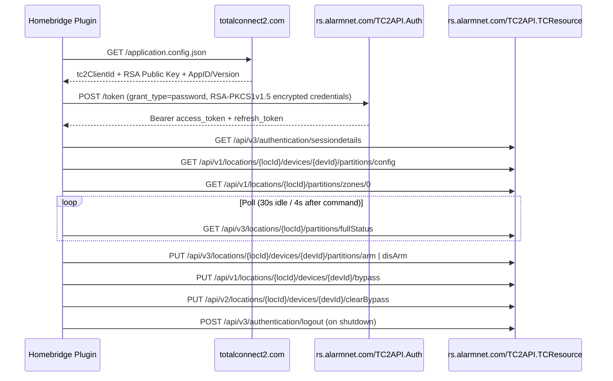

<p align="center">
  
</p>

# homebridge-honeywell-totalconnect

<p align="center">
  <a href="https://github.com/homebridge/homebridge/wiki/Verified-Plugins"></a>
  <a href="https://www.npmjs.com/package/homebridge-honeywell-totalconnect"></a>
  <a href="https://github.com/NightPants/Homebridge_TotalConnect2_0/blob/main/LICENSE"></a>
  <a href="https://nodejs.org"></a>
</p>

Control your **Honeywell / Resideo Total Connect 2.0** security system from **Apple HomeKit** via [Homebridge](https://homebridge.io).

Built for **Homebridge 1.8 & 2.0+** and **Node.js 20 / 22 / 24 LTS** with zero external HTTP/crypto dependencies, an interactive **Test Login & Discover** configuration UI, full multi-location and multi-partition support, zone sensors, bypass management, and HomeKit-friendly automation switches.

---

## Features

- **Full Alarm Control in Apple Home**
  - Arm **Home** (`Stay`, `Stay Instant`, `Night Stay`, `Away`, or `Away Instant`), **Night** (auto-detects `Night Stay` support per partition and falls back to `Stay Instant`), **Away** (`Away` or `Away Instant`), and **Off** (`Disarm`).
  - Optional **Arm-Only Lockdown (`allowDisarm: false`)** so HomeKit and Siri can arm your alarm but can never disarm it.
  - Real-time **Alarm Triggered** state across Burglary/Police, Fire/Smoke, and Carbon Monoxide alarms, plus **AC Power Loss**, **Low Panel Battery**, and **Cover Tamper** reporting.
  - Works with **VISTA** (`15P`, `20P`, `21iP`), **Lynx Touch**, **Lyric**, and **ProSeries / ProA7** panels.
- **Multi-Location & Multi-Partition**
  - Automatically discovers every enabled location on your Total Connect account.
  - Expose all partitions at a location as a **single unified Security System** (`combined`) or each partition as its **own Security System accessory** (`separate`).
- **Smart Zone Sensors**
  - Automatically exposes panel zones as native HomeKit **Contact**, **Motion**, **Smoke**, **Carbon Monoxide**, **Leak / Flood**, or **Occupancy** sensors based on Honeywell `ZoneType` and zone naming — or customize any zone with one click.
  - Automatically hides panic buttons, keypads, and RF keyfobs (`hideButtonZones: true` by default).
  - Reports **Tamper**, **Low Battery**, **Supervision / Trouble Fault**, and **Bypassed (`StatusActive`)** states on every sensor.
- **Built for HomeKit Automations**
  - **Arm-Only Switches (`Arm Away`, `Arm Home`, `Arm Night`)**: Apple Home requires manual iPhone confirmation to run `SecuritySystem` automations (such as *"When the last person leaves home"*). Arm-only switches run without confirmation prompts and **can never disarm** your panel.
  - **Auto-Bypass Open Zones on Arm (`autoBypassOnArm`)**: If arming fails because a bypassable window/zone is open, automatically bypasses the open zone(s) and retries arming.
  - **Auto-Bypass Low-Battery Zones (`autoBypassLowBattery`)**: Automatically bypasses bypassable zones reporting low battery while disarmed.
  - **Bypass Open Zones / Clear Bypass Buttons** & **Per-Zone Bypass Switches**.
  - **Alarm Triggered Contact Sensor (`alarmSensor`)**: Opens whenever the panel is alarming so HomeKit automations can turn on all lights, unlock doors, or trigger sirens.
- **One-Click Configuration UI**
  - Includes a custom Homebridge UI screen (**Test Login & Discover**) that signs in, lists your locations, partitions, and zones with live status, and lets you configure sensor overrides without looking up IDs.
- **Security First**
  - RSA `PKCS#1 v1.5` credential encryption before transmission, `*.alarmnet.com` HTTPS host pinning, redirect blocking, credential lockout circuit breaker, automatic log secret redaction, and environment-variable secret support. See [SECURITY.md](./SECURITY.md).

---

## Prerequisites & Recommended Account Setup

1. **Active Total Connect 2.0 Subscription**: Your panel must be connected to Resideo AlarmNet with Total Connect 2.0 remote services enabled.
2. **Create a Dedicated Homebridge User (Recommended)**:
   - Sign in at [totalconnect2.com](https://totalconnect2.com) → **Users** → **Add User**.
   - Create a dedicated user (e.g., `homebridge`) with **User / Standard** access to the locations and partitions you want in HomeKit, and assign it a **4–8 digit Panel User Code**.
   - **Keep Two-Factor Authentication (MFA / Email OTP) turned OFF** on this dedicated service account. Background Homebridge daemons cannot read interactive email OTP codes when tokens expire. (You can keep MFA enabled on your personal master login!)
3. **Enable "Sensor Events" for Live Zone Open/Close Updates**:
   - Total Connect 2.0 only reports live non-alarm `FAULT` (door/window open) changes on zones when **Sensor Events / Zone Notification** is enabled on your account by your AlarmNet dealer. Without it, arming/disarming and alarm states still work normally, while zones remain closed until an alarm event.
4. **Panel Sync**: If you recently added or renamed zones on your keypad, run **Sync Panel Data** once in the Total Connect mobile/web app so zone names appear in the API.

---

## Installation

### Option A: Homebridge Web UI (Recommended)

1. Open the **Homebridge UI** → **Plugins**.
2. Search for `homebridge-honeywell-totalconnect` and click **Install**.

### Option B: Terminal / Command Line

```bash
npm install -g homebridge-honeywell-totalconnect
# or with hb-service on Linux / Raspberry Pi:
sudo hb-service add homebridge-honeywell-totalconnect
```

### Option C: Install Directly from GitHub / Local Clone

```bash
git clone https://github.com/NightPants/Homebridge_TotalConnect2_0.git
cd Homebridge_TotalConnect2_0
npm ci
npm run build
npm link
```

If Homebridge runs under its own global Node environment (for example on Linux / Raspberry Pi / hb-service), link or install the built package into Homebridge's prefix:

```bash
sudo hb-service add homebridge-honeywell-totalconnect
# or install directly from a tarball:
npm pack
sudo npm install -g ./homebridge-honeywell-totalconnect-1.0.1.tgz
```

Restart Homebridge after installing.

---

## Configuration

### Using the Homebridge Settings UI (Recommended)

1. Open **Plugins** → **Honeywell Total Connect 2.0** → **Settings**.
2. Enter your **Total Connect Username**, **Password**, and **4–8 digit Panel User Code**.
3. Click **Test Login & Discover** at the top of the dialog:
   - Verifies your login and displays every **Location ID**, **Partition**, and **Zone**.
   - Shows each zone's live state (`Open`/`Closed`, `Bypassed`, `Low battery`) and auto-detected HomeKit sensor type.
   - Use the **Type** dropdown next to any zone to change it (e.g., `Contact` → `Motion`, `Leak`, or `Hidden`) with a single click.
4. Expand **Arming**, **Automations & Extras**, or **Zones** to tailor behavior, then click **Save** and restart Homebridge.

### Keeping Secrets Out of `config.json` (Environment Variables)

You can omit credentials from `config.json` (or override them) by setting environment variables on the Homebridge process (`hb-service`, `systemd`, or Docker):

| Environment Variable | Description |
| --- | --- |
| `TOTALCONNECT_USERNAME` | Overrides `username` |
| `TOTALCONNECT_PASSWORD` | Overrides `password` |
| `TOTALCONNECT_USERCODE` | Overrides default `userCode` |

### Manual `config.json` Example

```json
{
  "platforms": [
    {
      "platform": "HoneywellTotalConnect",
      "name": "Total Connect",
      "username": "homebridge-user@example.com",
      "password": "your-password",
      "userCode": "1234",
      "partitionMode": "combined",
      "homeMode": "stay",
      "nightMode": "auto",
      "awayMode": "away",
      "allowDisarm": true,
      "autoBypassOnArm": false,
      "autoBypassLowBattery": false,
      "armingSwitches": ["away", "night"],
      "bypassSwitches": true,
      "alarmSensor": true,
      "zoneExposure": "all",
      "excludeZoneIds": [],
      "hideButtonZones": true,
      "zoneBypassSwitches": false,
      "zoneOverrides": [
        {
          "zoneId": 4,
          "name": "Basement Sump",
          "type": "leak"
        }
      ],
      "pollingInterval": 30,
      "fastPollingInterval": 4,
      "requestTimeout": 30,
      "verboseLogging": false
    }
  ]
}
```

### Configuration Reference

| Option | Type | Default | Description |
| --- | --- | --- | --- |
| `name` | `string` | `"Total Connect"` | Platform display name in logs. |
| `username` | `string` | *required* | Total Connect 2.0 username (or set `TOTALCONNECT_USERNAME`). |
| `password` | `string` | *required* | Total Connect 2.0 password (or set `TOTALCONNECT_PASSWORD`). |
| `userCode` | `string` | `"-1"` | 4–8 digit keypad user code used for arm/disarm/bypass (`"-1"` if your panel doesn't require one). |
| `locations` | `array` | `[]` | Optional per-location overrides: `{ locationId, name, userCode, enabled }`. |
| `partitionMode` | `"combined" \| "separate"` | `"combined"` | `"combined"` creates one Security System per location; `"separate"` creates one per partition. |
| `homeMode` | `string` | `"stay"` | Panel mode used for HomeKit **Home**: `"stay"`, `"stayInstant"`, `"night"`, `"away"`, `"awayInstant"`. |
| `nightMode` | `string` | `"auto"` | Panel mode for HomeKit **Night**: `"auto"` (`Night Stay` if supported, else `Stay Instant`), `"night"`, `"stayInstant"`, `"stay"`, `"away"`, `"awayInstant"`, or `"disabled"`. |
| `awayMode` | `string` | `"away"` | Panel mode for HomeKit **Away**: `"away"` or `"awayInstant"`. |
| `allowDisarm` | `boolean` | `true` | Set `false` to block disarming from HomeKit/Siri. |
| `autoBypassOnArm` | `boolean` | `false` | When arming fails due to open zone(s), bypass open bypassable zones and retry arming. |
| `autoBypassLowBattery` | `boolean` | `false` | Automatically bypass bypassable zones that report low battery while disarmed. |
| `armingSwitches` | `string[]` | `[]` | Expose confirmation-free arm-only switches: any of `"away"`, `"stay"`, `"night"`. |
| `bypassSwitches` | `boolean` | `false` | Add momentary **Bypass Open Zones** and **Clear Bypass** switches. |
| `alarmSensor` | `boolean` | `false` | Add an **Alarm** contact sensor that opens whenever the alarm is triggered. |
| `zoneExposure` | `"all" \| "selected" \| "none"` | `"all"` | Control which zones are exposed to HomeKit. |
| `zoneIds` | `number[]` | `[]` | Zone IDs to include when `zoneExposure` is `"selected"`. |
| `excludeZoneIds` | `number[]` | `[]` | Zone IDs to exclude. |
| `hideButtonZones` | `boolean` | `true` | Hide keyfobs, keypads, and 24-hour panic buttons unless explicitly overridden. |
| `zoneBypassSwitches` | `boolean` | `false` | Add a bypass switch to each bypassable zone (turning OFF clears all bypasses on that partition). |
| `zoneOverrides` | `array` | `[]` | Per-zone customization: `{ locationId?, zoneId, name?, type }`. |
| `pollingInterval` | `number` | `30` | Background status poll interval in seconds (`10`–`3600`). |
| `fastPollingInterval` | `number` | `4` | Rapid status poll interval in seconds (`2`–`30`) for 150 s after any command. |
| `requestTimeout` | `number` | `30` | Per-HTTP request timeout in seconds (`5`–`120`). |
| `verboseLogging` | `boolean` | `false` | Log redacted API traffic at `info` level for troubleshooting. |

---

## HomeKit Automations Guide

### 1. Hands-Free "When Last Person Leaves" & "Goodnight" Arming
By Apple's security design, automations that change a `SecuritySystem` accessory prompt your iPhone for manual confirmation before running.
To arm **automatically without prompts**:
1. Enable `armingSwitches: ["away", "night"]` in the plugin settings.
2. In Apple Home, create an automation (*When the last person leaves home* → turn **ON** `Arm Away`, or add `Arm Night` = **ON** to your *Goodnight* scene).
3. Turning an arm-only switch **OFF** is intentionally a no-op — it bounces back to match the panel state and **never disarms** the alarm.

### 2. Whole-Home Emergency Response When Alarm Triggers
Enable `alarmSensor: true` to add a dedicated `{Location} Alarm` Contact Sensor:
- **Closed** = Normal
- **Open** = Panel is in active alarm (Burglary, Fire/Smoke, or CO)

In Apple Home, create an automation: *When `{Location} Alarm` Opens* → turn all interior/exterior lights to 100%, set exterior smart bulbs to red, or play an alert tone on HomePods.

### 3. Using Entry Doors & Motion Zones for Lighting
When your AlarmNet dealer has **Sensor Events** enabled, every door, window, and motion sensor on your alarm panel works as a native HomeKit sensor (e.g., *When Basement Door opens → turn on Basement Stairs light*). Note that cloud polling updates every `pollingInterval` seconds (`30 s` default, `10 s` minimum).

---

## Technical Overview: Total Connect 2.0 REST API

Based on a full review of `https://rs.alarmnet.com/TC2API.TCResource/Help` and Resideo's live web bootstrap (`https://totalconnect2.com/application.config.json`):



> **Note on Legacy Endpoints**: Although the static `/Help` documentation still lists `POST api/v1/authentication/login`, modern Total Connect 2.0 deployments authenticate via `POST https://rs.alarmnet.com/TC2API.Auth/token` using dynamic OAuth client parameters and RSA-encrypted credentials, then attach `Authorization: Bearer <token>` to `/TC2API.TCResource/api/...` endpoints.

---

## Troubleshooting

| Symptom / Log Message | Cause & Fix |
| --- | --- |
| `Total Connect rejected the username or password (-50004)` | Double-check credentials at `totalconnect2.com`. Ensure MFA / Email OTP is disabled for the Homebridge user. The plugin stops retrying automatically so it will not lock your account. |
| `Total Connect account is locked (-123)` | Sign in at `totalconnect2.com` in a browser to unlock the account, verify the password in Homebridge settings, then restart Homebridge. |
| `the panel rejected the user code (-4106 / -4114)` | Set `userCode` to the 4–8 digit keypad PIN assigned to that Total Connect user on your alarm panel, and make sure the user is synced to the panel in the TC2 app. |
| `the panel refused the command (-4502)` | Usually a door or window zone is faulted (open), or the panel is already in the requested state. Close the open zone, use **Bypass Open Zones**, or enable `autoBypassOnArm`. |
| Zones appear in HomeKit but never show "Open" | Ask your AlarmNet dealer to enable **Sensor Events** on your Total Connect 2.0 account; without it, TC2 only updates zone states during alarms or bypasses. |
| Accessory shows **No Response** in Apple Home | Total Connect cloud has been unreachable for more than 4 polling intervals (~2–5 min). The plugin automatically backs off and recovers as soon as Resideo's servers respond. |

---

## Development

```bash
npm run lint        # ESLint across TypeScript & custom UI scripts
npm run typecheck   # Strict TypeScript type-checking (src + tests)
npm test            # Vitest unit & platform integration suite
npm run build       # Clean compile to dist/
```

---

## Disclaimer & License

This project is an independent community Homebridge integration and is not affiliated with, endorsed by, or supported by Honeywell International Inc. or Resideo Technologies, Inc. Use at your own risk; never rely on smart-home integrations as a life-safety system.

Licensed under the [MIT License](./LICENSE).
